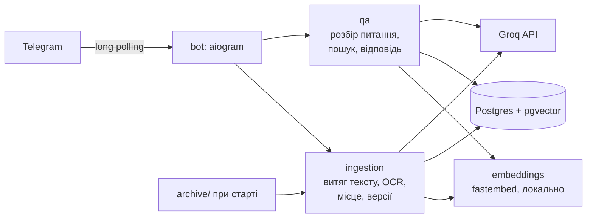
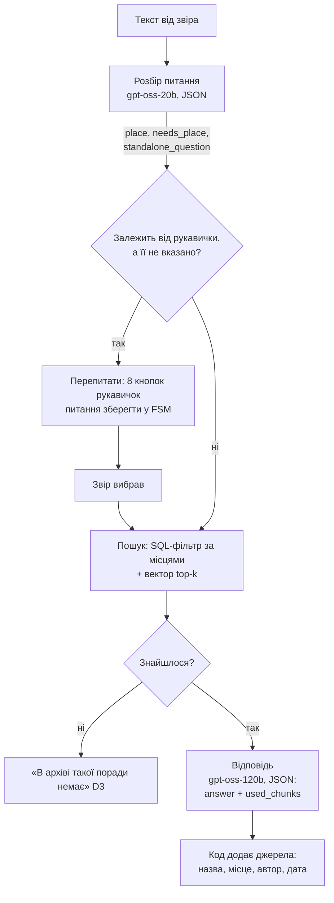
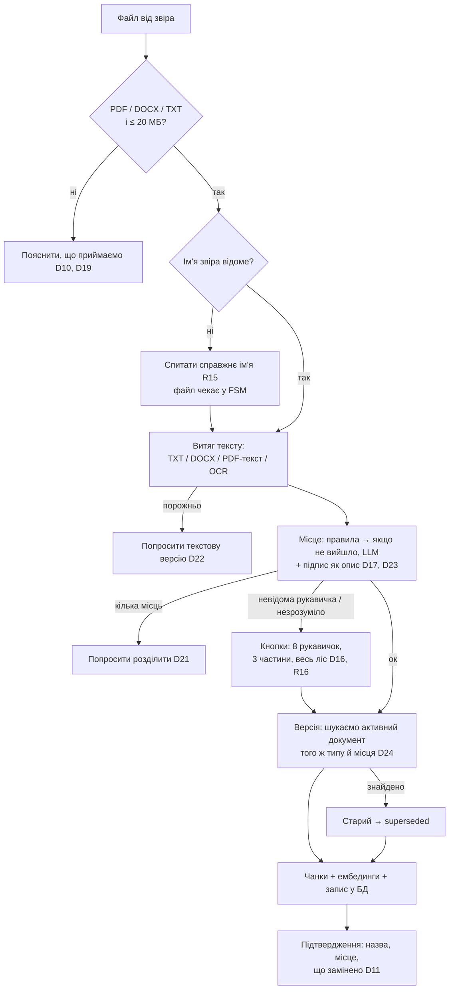

# Архітектура бота «Лісовий архів»

Вимоги й рішення, на які посилається цей документ (R*, D*), — у [requirements.md](requirements.md).

## 1. Загальна схема



Два сервіси в `docker-compose.yml`: `db` (Postgres 16 + pgvector) і `bot`. Запуск — `docker compose up --build`, токени — у `.env`.

## 2. Ключові ідеї

1. **Місце дії — це фільтр у SQL, а не здогадка LLM.** Карта лісу (R18) захардкоджена в коді й у таблиці `places`. Для рукавички «Під вербою» шукаємо лише серед документів для `forest`, `deciduous`, `river`, `pid_verboyu` — поради інших рукавичок до LLM навіть не потрапляють (R9).
2. **Пріоритет рівнів (R10) і суперечності (D15) вирішує LLM, але за явною розміткою.** Кожен фрагмент у промпті підписаний рівнем: `[рукавичка «Біля бобрової греблі»]`, `[частина лісу: біля річки]`, `[весь ліс]`. Правило «конкретніше перемагає; рівні частини лісу — показати обидві» — у системному промпті й покрите тестами.
3. **Джерела формує код, а не LLM.** LLM повертає JSON із номерами використаних фрагментів; автора, дату й назву документа підставляє код з БД (R13, R14, D20). Так модель не може вигадати автора чи дату.
4. **Архів не витрачає ліміти Groq.** При старті архів індексується без жодного виклику LLM: текст — локально (з OCR), місце — правилами за заголовком і першим абзацом, ембединги — локальною моделлю.
5. **Ліміти безкоштовного Groq малі** (див. §4), тому промпт тримаємо в ~3–4 тис. токенів: лише відібрані фрагменти, коротка історія, `reasoning_effort=low`.

## 3. Потоки

### 3.1. Питання (текст без файла)



- **Розбір питання** (`qa/router.py`): спершу детерміновано шукаємо назву рукавички чи частини лісу за списком синонімів («у соснах», «біля сосон», «під дубом», «на узліссі»…). LLM отримує питання, останні кілька реплік (D8) і довідник типів документів за рівнями. Повертає:
  - `place` — рукавичка / частина лісу / `null`;
  - `needs_place` — чи є документи цього типу на рівні рукавички або частини лісу («Скільки внесок?» → так; «Що робити при пожежі?» → ні);
  - `standalone_question` — питання, переписане без контексту розмови («а під ялиною?» → «Скільки внесок під ялиною?»);
  - `is_forest_question` — для балачок і питань не про ліс (D12).
- **Пошук** (`qa/search.py`): `applicable_places(place)` = `forest` + частини лісу рукавички + сама рукавичка. Якщо місце не потрібне — шукаємо серед загальних і всіх документів. Top-k = 6 за косинусною схожістю, тільки `status = 'active'`.
- **Відповідь** (`qa/answer.py`): у промпті сьогоднішня дата за Києвом (D9), фрагменти з номерами й рівнями, правила R10/D15/D3. Модель відповідає українською (R5).

### 3.2. Документ (файл)



- **Витяг тексту** (`ingestion/extract.py`): TXT — UTF-8, запасний варіант cp1251; DOCX — `python-docx`; PDF — `pypdf`. Якщо на сторінці майже немає тексту — це скан (в архіві таких 19): рендеримо сторінку `pypdfium2` у 300 DPI, переводимо в ч/б із порогом (сірі плями фону зникають, чорний текст лишається) і розпізнаємо `tesseract` (`ukr`, `--psm 3`) через `image_to_data`. Слова з упевненістю < 60 відкидаємо — це сміття від плям; але слабке слово лишається, якщо в рядку ≥ 3 впевнених сусідів («Кабан» у «Кабан носить хмиз»). Насамкінець виправляємо типову помилку «за З гілки» → «за 3 гілки». Варіанти порівнювалися на всіх сканах архіву; цей дає правильний порядок блоків і зберігає всі числа.
- **Місце** (`ingestion/placement.py`): правила за заголовком і першими реченнями («рукавички „Під дубом“», «хвойного лісу», «для всіх мешканців лісу»). На архіві правила працюють для всіх 78 файлів (є тест), LLM не потрібна. Документи звірів завжди додатково проходять LLM (gpt-oss-20b) з результатом правил і підписом як підказками: лише модель помітить, що вступ «для всіх мешканців лісу», а розділи — окремо для хвойного й листяного (D21).
- **Тип документа** (D24): заголовок без назви місця, нормалізований («Членські внески рукавички „Під дубом“» → `членські внески`). Якщо точного збігу немає, LLM отримує список назв активних документів того ж місця й вирішує, чи це нова версія одного з них.
- **Чанкінг**: документ до ~1500 символів — один чанк (усі архівні). Довші ділимо за заголовками й абзацами (~800 символів із перекриттям), заголовок документа додаємо до кожного чанка.

### 3.3. Команди

| Команда | Що робить |
|---------|-----------|
| `/start` | Привітання й коротка інструкція |
| `/help` | Що вміє бот, які формати приймає |
| `/name <ім'я>` | Змінити справжнє ім'я (D14) |
| `/docs` | Усі активні документи, згруповані за місцем: назва, автор, дата (D18) |
| `/my_docs` | Власні документи звіра з кнопкою «Видалити» (D5) |

Видалення: документ отримує статус `deleted`. Якщо він колись замінив попередню версію, та знову стає активною (D25).

### 3.4. Інше

- Групові чати бот ігнорує (R2).
- Голосові, фото, стікери, інші формати — пояснення, що бот розуміє (D10).
- Помилка 429 від Groq — повтор з очікуванням `retry-after`, а якщо не вдалося — «Зараз багато питань, спробуйте за хвилинку».

## 4. Стек

| Що | Вибір | Чому |
|----|-------|------|
| Мова | Python 3.12 | |
| Telegram | aiogram 3 | async, FSM для діалогів (ім'я, вибір місця), фільтри, middleware |
| LLM | Groq: `openai/gpt-oss-120b` — відповіді; `openai/gpt-oss-20b` — розбір питання й класифікація документів | Production-моделі, доступні на безкоштовному рівні. Ліміти рахуються для кожної моделі окремо: по ~8K TPM, 1K RPD, 200K TPD. Назви моделей задаються в env |
| SDK | `groq` (офіційний) | |
| БД | Postgres 16 + pgvector, драйвер `asyncpg` | Вимога вакансії — SQL/Postgres; запити пишемо вручну |
| Міграції | прості `.sql`-файли + таблиця `schema_migrations` | Прозоро, без зайвих залежностей |
| Ембединги | `fastembed` + `paraphrase-multilingual-MiniLM-L12-v2` (384 виміри) | Groq не має ембедингів; ONNX без torch, модель вантажиться під час збирання образу |
| PDF | `pypdf` (текст), `pypdfium2` (рендер сторінок) | Ліцензії MIT/Apache, без AGPL |
| OCR | `tesseract-ocr` + `tesseract-ocr-ukr`, `pytesseract`, `Pillow` | Локально, без лімітів |
| DOCX | `python-docx` | |
| Налаштування | `pydantic-settings` | Токени з env |
| Залежності | `uv` + `pyproject.toml` + `uv.lock` | |
| Тести | `pytest`, `pytest-asyncio`, `pytest-mock` | Вимога вакансії: unit-тести й моки |
| Лінтер | `ruff` | |

## 5. Структура репозиторію

```
.
├── README.md                  # запуск, що вміє бот, рішення
├── docker-compose.yml         # db + bot
├── Dockerfile
├── .env.example               # TELEGRAM_BOT_TOKEN, GROQ_API_KEY, ...
├── pyproject.toml / uv.lock
├── docs/
│   ├── requirements.md        # вимоги й рішення
│   └── architecture.md        # архітектура (цей файл)
├── archive/                   # «Лісовий архів», 78 файлів, індексуються при старті
├── migrations/
│   └── 001_init.sql
├── src/forest_bot/
│   ├── __main__.py            # міграції → індекс архіву → polling
│   ├── config.py              # Settings (pydantic-settings)
│   ├── forest.py              # місця, карта лісу, синоніми, applicable_places()
│   ├── db/
│   │   ├── pool.py            # asyncpg pool + реєстрація pgvector
│   │   ├── migrate.py
│   │   ├── fsm_storage.py     # FSM aiogram у Postgres (стан переживає рестарт)
│   │   └── repositories/      # users.py, documents.py, chunks.py, messages.py
│   ├── ingestion/
│   │   ├── extract.py         # TXT / DOCX / PDF / OCR
│   │   ├── placement.py       # місце дії: правила + LLM
│   │   ├── chunking.py
│   │   ├── service.py         # прийом документа: версії, збереження
│   │   └── archive_seed.py    # індексування archive/ (ідемпотентно, за хешем)
│   ├── qa/
│   │   ├── router.py          # розбір питання
│   │   ├── search.py
│   │   ├── answer.py          # промпт, JSON, джерела
│   │   └── service.py
│   ├── llm/
│   │   ├── client.py          # обгортка Groq: JSON-режим, повтори, 429
│   │   └── prompts.py
│   ├── embeddings.py
│   └── bot/
│       ├── app.py             # Dispatcher, роутери, middleware
│       ├── handlers/          # start, documents, questions, commands, fallback
│       ├── keyboards.py
│       └── texts.py           # усі тексти бота українською
└── tests/
    ├── unit/                  # forest, extract, placement, chunking, versioning,
    │                          # router, answer (LLM замокано), handlers
    ├── integration/           # з Postgres із docker compose (позначка @pytest.mark.db)
    └── fixtures/              # кілька файлів з архіву, зокрема скан
```

## 6. Схема БД

```sql
CREATE EXTENSION IF NOT EXISTS vector;

-- Місця: весь ліс, 3 частини, 8 рукавичок (заповнюється в міграції)
CREATE TABLE places (
    code  text PRIMARY KEY,                -- 'forest', 'coniferous', 'pid_dubom', ...
    level text NOT NULL CHECK (level IN ('forest', 'part', 'mitten')),
    name  text NOT NULL UNIQUE              -- 'Весь ліс', 'Хвойний ліс', 'Під дубом'
);

-- Карта лісу (R18): до яких частин лісу належить рукавичка
CREATE TABLE mitten_parts (
    mitten_code text REFERENCES places(code),
    part_code   text REFERENCES places(code),
    PRIMARY KEY (mitten_code, part_code)
);

CREATE TABLE users (
    telegram_id  bigint PRIMARY KEY,
    display_name text,                      -- «справжнє ім'я» (R15); NULL, поки не спитали
    created_at   timestamptz NOT NULL DEFAULT now(),
    updated_at   timestamptz NOT NULL DEFAULT now()
);

CREATE TABLE documents (
    id             bigserial PRIMARY KEY,
    title          text NOT NULL,           -- заголовок з документа
    doc_type       text NOT NULL,           -- нормалізований тип без місця (D24)
    place_code     text NOT NULL REFERENCES places(code),
    source         text NOT NULL CHECK (source IN ('archive', 'user')),
    author_id      bigint REFERENCES users(telegram_id),  -- NULL для архіву (D20)
    file_name      text NOT NULL,
    file_sha256    text NOT NULL,
    extraction     text NOT NULL CHECK (extraction IN ('text', 'ocr')),
    full_text      text NOT NULL,
    status         text NOT NULL DEFAULT 'active'
                   CHECK (status IN ('active', 'superseded', 'deleted')),
    replaces_id    bigint REFERENCES documents(id),        -- яку версію замінив
    uploaded_at    timestamptz NOT NULL,    -- для архіву: 2026-10-13 (D13)
    CHECK (source = 'archive' OR author_id IS NOT NULL)
);

-- Не більше одного активного документа одного типу для одного місця (R11)
CREATE UNIQUE INDEX documents_one_active_version
    ON documents (doc_type, place_code) WHERE status = 'active';
CREATE UNIQUE INDEX documents_archive_file
    ON documents (file_sha256) WHERE source = 'archive';
CREATE INDEX documents_author ON documents (author_id) WHERE status = 'active';

CREATE TABLE chunks (
    id          bigserial PRIMARY KEY,
    document_id bigint NOT NULL REFERENCES documents(id) ON DELETE CASCADE,
    position    int NOT NULL,
    content     text NOT NULL,
    embedding   vector(384) NOT NULL,
    UNIQUE (document_id, position)
);
-- Документів сотні, а не мільйони: точний пошук швидший і простіший за HNSW.

-- Коротка історія розмови для уточнень (D8)
CREATE TABLE messages (
    id         bigserial PRIMARY KEY,
    user_id    bigint NOT NULL REFERENCES users(telegram_id),
    role       text NOT NULL CHECK (role IN ('user', 'assistant')),
    content    text NOT NULL,
    created_at timestamptz NOT NULL DEFAULT now()
);
CREATE INDEX messages_user_time ON messages (user_id, created_at DESC);

-- Стан діалогів aiogram (очікуємо ім'я / вибір місця)
CREATE TABLE fsm_state (
    key   text PRIMARY KEY,
    state text,
    data  jsonb NOT NULL DEFAULT '{}'
);
```

Головний запит пошуку:

```sql
SELECT c.id, c.content, d.title, d.place_code, p.level, d.source,
       u.display_name AS author, d.uploaded_at,
       c.embedding <=> $1 AS distance
FROM chunks c
JOIN documents d ON d.id = c.document_id
JOIN places p    ON p.code = d.place_code
LEFT JOIN users u ON u.telegram_id = d.author_id
WHERE d.status = 'active'
  AND d.place_code = ANY($2)               -- applicable_places(place)
ORDER BY distance
LIMIT $3;
```

Заміна версії — одна транзакція: старий документ → `superseded`, новий вставляється з `replaces_id`. Унікальний частковий індекс гарантує, що двох активних версій не буде навіть при одночасних запитах.

## 7. Тестування

- **Unit (з моками)**: карта лісу й `applicable_places`; витяг тексту з фікстур (TXT, DOCX, текстовий PDF; OCR — `pytesseract` замокано); визначення місця правилами на всіх 78 назвах архіву; нормалізація типу документа; розбір відповіді LLM і формування джерел; хендлери aiogram із замоканими сервісами (ім'я при першому документі, перепитування рукавички, відмова для файлу > 20 МБ).
- **Інтеграційні** (Postgres із compose): версіонування й унікальний індекс, пошук із фільтром місць, відновлення попередньої версії при видаленні.
- **Перевірка якості** (`scripts/eval.py`, справжній Groq, вручну): 14 сценаріїв з requirements.md §3 — порівняння відповідей з очікуваними.

## 8. Ризики

| Ризик | Що робимо |
|-------|-----------|
| OCR погано читає скани з плямистим фоном | Рендер 300 DPI, сірий, підсилення контрасту, `--psm 6`; перевіряємо на всіх 20 сканах архіву |
| 8K TPM на безкоштовному Groq | Короткий промпт, top-6 фрагментів, `reasoning_effort=low`, обробка 429, моделі в env |
| Модель порушує пріоритет або вигадує | Розмітка рівнів у промпті, JSON з номерами фрагментів, тест-сценарії, «не знаю» при порожньому пошуку |
| Розмір образу через модель ембедингів | MiniLM (~220 МБ), завантажується при збиранні образу |
